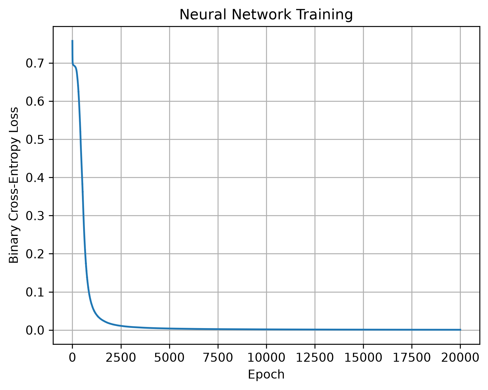

# Neural Network from Scratch

Implementación de una red neuronal multicapa (MLP) desde cero utilizando Python y NumPy, sin frameworks de Deep Learning.

## Objetivo

Construir y entrenar una red neuronal capaz de resolver el problema XOR mediante propagación hacia adelante, retropropagación y descenso del gradiente.

## Arquitectura

La red utiliza una arquitectura 2-4-1:

- Capa de entrada: 2 neuronas.
- Capa oculta: 4 neuronas con activación ReLU.
- Capa de salida: 1 neurona con activación Sigmoid.

## Fundamentos matemáticos

### Forward Propagation

Capa oculta:

Z1 = XW1 + b1

A1 = ReLU(Z1)

Capa de salida:

Z2 = A1W2 + b2

Y_pred = Sigmoid(Z2)

### Función de pérdida

Se utiliza Binary Cross-Entropy (BCE):

L = -1/m * sum(y*log(y_pred) + (1-y)*log(1-y_pred))

### Backpropagation

Se calculan manualmente los gradientes mediante la regla de la cadena.

Para la capa de salida:

dZ2 = Y_pred - Y

dW2 = A1.T @ dZ2 / m

db2 = mean(dZ2)

Para la capa oculta:

dZ1 = (dZ2 @ W2.T) * ReLU'(Z1)

dW1 = X.T @ dZ1 / m

db1 = mean(dZ1)

### Gradient Descent

Los parámetros se actualizan mediante:

W = W - learning_rate * dW

b = b - learning_rate * db

## Dataset: XOR

| X1 | X2 | Y |
|---|---|---|
| 0 | 0 | 0 |
| 0 | 1 | 1 |
| 1 | 0 | 1 |
| 1 | 1 | 0 |

## Configuración del entrenamiento

- Épocas: 20.000
- Learning rate: 0.1
- Función de pérdida: Binary Cross-Entropy
- Optimizador: Gradient Descent

## Resultados

| Entrada | Predicción |
|---|---:|
| [0, 0] | 0.0025 |
| [0, 1] | 0.9997 |
| [1, 0] | 0.9998 |
| [1, 1] | 0.0002 |

La red clasificó correctamente los cuatro ejemplos de XOR.

Pérdida final aproximada: 0.000875.



## Estructura del proyecto

```text
Red_Neuronal/
├── README.md
├── training_loss.png
├── src/
│   ├── activations.py
│   ├── loss.py
│   ├── neural_network.py
│   └── main.py
└── tests/
    └── test_neural_network.py
```

## Requisitos

- Python 3
- NumPy
- Matplotlib

## Ejecución

Desde la raíz del repositorio:

```bash
python Red_Neuronal/src/main.py
```

## Pruebas

```bash
python -m unittest discover -s Red_Neuronal/tests -v
```

## Limitaciones

El modelo fue evaluado utilizando el mismo conjunto XOR empleado durante el entrenamiento. Por lo tanto, los resultados demuestran que aprendió el problema planteado, pero no constituyen una evaluación de generalización sobre datos independientes.

## Tecnologías

- Python
- NumPy
- Matplotlib